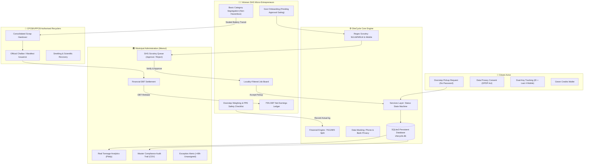

# ♻️ SheCycle: Women-Led Smart E-Waste Management & Recycling Hub

> **IEEE WIE HackEarth Hackathon | Theme: Sustainability & Climate**  
> **Pilot Cluster:** Meerut, Uttar Pradesh, India  
> *"Transforming E-Waste Management into Women-Led Prosperity"*

---

## 📌 Executive Summary & Problem Statement

India is the world's third-largest producer of electronic waste, generating over **1.71 million metric tonnes** annually. Alarmingly, **over 90% of e-waste is channeled into informal scrapyards**, where unscientific open-air burning, crude acid leaching, and dumping contaminate suburban soil and groundwater with neurotoxic heavy metals (Lead, Cadmium, Mercury).

Meanwhile, India hosts one of the world's largest grassroots networks of women: **over 85 million women organized into Self-Help Groups (SHGs)** under the Ministry of Rural Development's **DAY-NRLM** and Ministry of Housing and Urban Affairs' **DAY-NULM**. While these groups possess unmatched neighborhood trust and doorstep reach, they lack formal, dignified micro-enterprise models in the green economy.

### 🎯 The SheCycle Solution
**SheCycle** bridges this critical gap. It is an end-to-end municipal circular-economy platform that transforms residential e-waste collection into safe, dignified green livelihood opportunities for women:
1. **Citizens** request doorstep pickup without login friction, receiving instant Green Credits.
2. **Verified Women SHGs** collect, digitally weigh, follow strict safety checklists, and conduct non-hazardous aggregation in their local wards.
3. **CPCB-Authorised Recyclers** receive consolidated consignments with tamper-evident digital challans.
4. **Municipal Regulators** oversee real-time tonnage flows, scrutinize SHG registrations, and maintain an immutable compliance audit trail aligned with India's **E-Waste (Management) Rules 2022** and **DPDP Act 2023**.

---

## 🏛️ System Architecture



---

## 🔄 6-Stage Statutory Compliance Pipeline

Unlike simple prototypes with binary "Pending/Collected" flags, SheCycle implements a strict, tamper-evident 6-stage lifecycle recorded in the `status_history` table:

```
[Requested] ➔ [Assigned] ➔ [Collected] ➔ [Sorted] ➔ [Delivered to Recycler] ➔ [Settled]
```

1. **Requested:** Citizen submits item details, estimated weight, and preferred slot.
2. **Assigned:** Verified SHG operating in that specific ward accepts the job.
3. **Collected:** SHG verifies actual weight on calibrated digital scales and confirms the PPE safety checklist (protective gloves, sealed battery pouches).
4. **Sorted:** SHG performs non-hazardous category segregation (metals, PCBs, plastics). *Compliance Rule: Industrial dismantling is prohibited; lithium batteries remain intact.*
5. **Delivered to Recycler:** Aggregated scrap is handed over to a CPCB-authorised recycler with an official manifest challan number.
6. **Settled:** Municipal finance officers reconcile recycler weigh-bills and disburse the 75% net share to the SHG's bank account via Direct Bank Transfer (DBT).

---

## 💰 Statutory Revenue Sharing Model

All gross scrap earnings are computed from a configurable rates table and reconciled to sum **exactly to 100%**:

| Stakeholder / Fund | Share (%) | Purpose |
| :--- | :---: | :--- |
| **Women SHG Micro-Entrepreneurs** | **75.0%** | Direct livelihood income deposited into group bank accounts via DBT. |
| **Logistics & Safety Equipment Fund** | **12.0%** | Handheld digital scales, puncture-proof battery pouches, and PPE kits. |
| **Municipal Platform & Audit Fee** | **8.0%** | Software hosting, GIS dispatch, and statutory regulatory compliance. |
| **Green Credits Municipal Pool** | **5.0%** | Citizen property-tax rebates and community eco-partner incentives. |
| **Total Reconciliation** | **100.0%** | *Strictly validated via automated unit test suite.* |

*Note: Scrap rates (e.g. ₹120/kg for smartphones, ₹150/kg for batteries) are illustrative demo benchmarks.*

---

## 🛡️ Data Privacy & Regulatory Compliance

- **Digital Personal Data Protection (DPDP) Act 2023 Alignment:**
  - **Data Masking Everywhere:** Citizen mobile numbers (e.g., `98XXXXXX10`) and SHG bank accounts (e.g., `****1234`) are masked across all user, SHG, and admin views.
  - **Dual-Key Tracking:** Citizen tracking requires both the **Request ID** (e.g., `EW-00001`) and the **last 4 digits of the mobile number**, preventing open phone-number enumeration.
  - **Purpose Limitation:** Explicit consent checkbox before submission guaranteeing zero third-party monetization.
- **E-Waste (Management) Rules 2022 Alignment:**
  - SHGs operate strictly within **Collection & Aggregation** statutory boundaries.
  - Hazardous fractions (Lithium-ion batteries) are transported unopened in fire-retardant pouches.
  - Complete chain-of-custody exportable to CSV for Central Pollution Control Board (CPCB) EPR audits.

---

## ⚡ Quick Demo Guide (Judges 2-Minute Click-Path)

### Demo Credentials

| Role | Username / ID | Security PIN / Password | Operating Area / Context |
| :--- | :--- | :--- | :--- |
| **🏛️ Municipal Admin** | *Click "One-Click Judge Login"* | `meerut2026` | Full Meerut Nagar Nigam cluster |
| **👩‍🦰 Approved SHG (Urban)** | `NULM-2024-88` *(Maa Durga SHG)* | `1234` | Kankar Khera, Modipuram, Pallavpuram |
| **🌾 Approved SHG (Rural)** | `NRLM-1024` *(Ekta Sakhi SHG)* | `1234` | Rohta Road, Partapur |
| **⏳ Pending SHG (Scrutiny)** | `NULM-2025-12` *(Nav Chetna Mandal)* | `1234` | Pending approval (Gated from jobs) |
| **🔍 Citizen Tracking Test** | `EW-00001` | Phone Last 4: `3210` | Kankar Khera (Status: Settled) |

---

## 🚀 2-Minute Demo Click-Path Script for Judges

1. **Step 1: Landing Page Impact Hub (0:00 - 0:30)**
   - View live counters: Tonnage collected (kg), active SHGs, completed pickups, and money paid to women.
   - Note the environmental badges: CO₂ avoided and toxic metals diverted from groundwater.
2. **Step 2: Citizen Portal (0:30 - 1:00)**
   - Toggle language to **हिंदी (Hindi)** to demonstrate bilingual accessibility.
   - Submit a test pickup request (Name: *Aakash Verma*, Mobile: *9811223344*, Ward: *Kankar Khera*, Category: *Smartphones*, Weight: *2.5 kg*).
   - Show instant **Request ID generation**, **QR Pass**, and estimated **Green Credits**.
   - Switch to **Track Request**, enter `EW-00001` + `3210`, and show the interactive **6-step visual timeline**.
3. **Step 3: Women SHG Portal (1:00 - 1:30)**
   - Click **"⚡ Quick Demo Login &rarr; Maa Durga SHG"**.
   - Navigate to **"Available Job Board"**: notice that only jobs in its operating wards (*Kankar Khera, Modipuram*) appear!
   - Navigate to **"My Collections Workflow"**:
     - Under **Assigned**, click **"Mark Collected"** (enters actual verified weight & checks mandatory PPE).
     - Under **Collected**, show the **CPCB statutory compliance rule** and complete basic segregation into fractions.
     - Under **Sorted**, select an authorised recycler (*Attero Recycling*) and enter the challan number.
   - Open **"Earnings & Statement"** to inspect the 75% revenue split and download the CSV statement.
4. **Step 4: Municipal Admin Dashboard (1:30 - 2:00)**
   - Click **"⚡ One-Click Judge Login (Admin)"**.
   - Inspect **Exception Alerts**: flags requests unassigned for > 48 hours.
   - Open **"Real Tonnage Analytics"**: interactive Plotly charts showing 60-day tonnage trends, ward distribution, and category share.
   - Open **"SHG Scrutiny Queue"**: view pending SHG *Nav Chetna Mahila Mandal*, enter notes, and click **Approve SHG**.
   - Open **"Master Compliance Audit Trail"**: show the full audit record and click **"Download Master Compliance Audit Trail (CSV)"**.

---

## 🛠️ Technology Stack

- **Frontend & App Framework:** [Streamlit](https://streamlit.io/) (Native wide layout, custom brand CSS)
- **Data Analytics & Charts:** [Pandas](https://pandas.pydata.org/), [Plotly Express](https://plotly.com/python/)
- **Persistence & Auditing:** Python standard library `sqlite3` with foreign key enforcement and automatic seed migrations
- **Security & Auth:** `hashlib` SHA-256 with cryptographically generated salts, DPDP masking utilities
- **Test Suite:** `pytest` (9 unit tests covering split reconciliation, regex validation, transitions, and privacy masking)

---

## 💻 How to Run Locally

### 1. Prerequisites
- Python 3.10+ (Tested on Python 3.13)
- Windows / Linux / macOS

### 2. Installation
```bash
# Navigate to the project directory
cd shecycle

# Install pinned dependencies
pip install -r requirements.txt
```

### 3. Run the Application
```bash
python -m streamlit run app.py
```
*The app will automatically open at `http://localhost:8501`.*

### 4. Run the Unit Test Suite
```bash
python -m pytest tests/
```
*All 9 unit tests will pass in < 0.5s.*

---

## 🗺️ Strategic Roadmap

- **Phase 1: Meerut Municipal Pilot (Current Finalist Stage)**
  - 3-5 verified SHGs across 10 core wards.
  - Handheld digital scale weighing and non-hazardous category sorting.
  - Fully offline-capable persistence for zero-downtime field demonstrations.
- **Phase 2: Scale-Up & MIS Integration (Q2 - Q4 2027)**
  - Offline-first Progressive Web App in Hindi and regional dialects.
  - Live API bridge with the **National Urban Livelihoods Mission (NULM)** portal for automated SHG credential verification.
  - WhatsApp Business Bot for voice-note pickup booking.
  - PFMS Direct Bank Transfer integration for instantaneous payout clearance.
- **Phase 3: Smart Cities & B2B EPR Exchange (2028+)**
  - Solar-powered smart drop-boxes with ultrasonic fill-level and strain-gauge weight sensors.
  - Automated B2B API integration with Producer Responsibility Organizations (PROs) and OEMs for statutory EPR credit compliance.

---

## 🔍 Honest Engineering Disclosures & Limitations

1. **Scrap Valuation:** Scrap rates (₹45 - ₹150/kg) are representative market benchmarks and will vary dynamically based on real-time recycler agreements.
2. **Government API Emulation:** DAY-NULM / DAY-NRLM registration verification is simulated via strict regex pattern validation (`NULM-YYYY-NN`, `NRLM-NNNN`) and duplicate rejection; live production will consume the MoHUA API.
3. **Environmental Impact Estimation:** CO₂ avoidance (1.44 kg CO₂e / kg scrap) and heavy metal diversion rates are derived from published UNEP and CPCB lifecycle studies.

---

*Developed with pride for the IEEE WIE HackEarth Hackathon 2026.*
