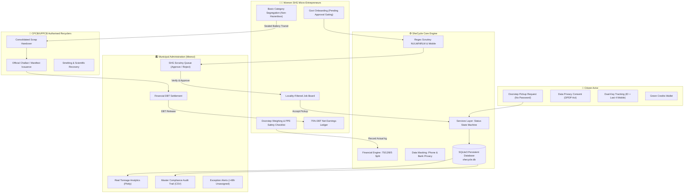

# ♻️ SheCycle: Women-Led Smart E-Waste Management & Recycling Hub

> **IEEE WIE HackEarth Hackathon | Theme: Sustainability & Climate**  
> **Team:** Zero Toxic (Pragya Rajwanshi, Rohit Kumar)  
> **Pilot Cluster:** Meerut, Uttar Pradesh, India  
> *"Transforming E-Waste Management into Women-Led Prosperity"*

---

## 📌 Executive Summary & Problem Statement

India is the world's third-largest producer of electronic waste, generating over **1.71 million metric tonnes** annually. Alarmingly, **over 90% of e-waste is channeled into informal scrapyards**, where unscientific open-air burning, crude acid leaching, and dumping contaminate suburban soil and groundwater with neurotoxic heavy metals (Lead, Cadmium, Mercury).

Meanwhile, India hosts one of the world's largest grassroots networks of women: **over 85 million women organized into Self-Help Groups (SHGs)** under the Ministry of Rural Development's **DAY-NRLM** and Ministry of Housing and Urban Affairs' **DAY-NULM**. While these groups possess unmatched neighborhood trust and doorstep reach, they lack formal, dignified micro-enterprise models in the green economy.

### 🎯 The SheCycle Solution
**SheCycle** bridges this critical gap. It is an end-to-end municipal circular-economy platform that transforms residential e-waste collection into safe, dignified green livelihood opportunities for women:
1. **Citizens** request doorstep pickup without login friction, receiving instant Green Credits.
2. **Verified Women SHGs** collect, digitally weigh, follow strict safety checklists, and conduct non-hazardous aggregation in their local wards.
3. **CPCB-Authorised Recyclers** receive consolidated consignments with tamper-evident digital challans.
4. **Municipal Regulators** oversee real-time tonnage flows, scrutinize SHG registrations, and maintain an immutable compliance audit trail aligned with India's **E-Waste (Management) Rules 2022** and **DPDP Act 2023**.

---

## 🎨 UI/UX Design System Upgrade

SheCycle has been elevated with an "advanced, hackathon-winning" design system engineered specifically for clarity, accessibility, and high visual polish:

- **Color Palette:**
  - **Deep Indigo (`#3B2F72`):** Primary branding, stability, municipal authority
  - **Vibrant Pink (`#E8318A`):** Accent, active states, women empowerment highlight
  - **Sustainability Green (`#1FA971`):** Verified success, eco-badges, approved status
  - **Soft Background (`#F7F5FC`):** Crisp, readable, modern canvas
  - **Subtle Borders (`#E6E1F5`):** Card definition and structural elegance
- **Typography & Hierarchy:**
  - Modern Google Fonts: **Plus Jakarta Sans** and **Inter** with line-height 1.55
  - Standardized headers (`render_page_header`) across all portals with icon, title, description, and status tags
- **Interactive Component Library:**
  - **Cards:** 16px border-radius, soft layered shadows, subtle hover lift animation
  - **Primary Buttons:** Indigo-to-pink gradient (`#3B2F72` &rarr; `#E8318A`) with hover elevation
  - **Status Stepper:** 6-stage responsive visual progress bar with pulse animations
  - **Form Alignment:** Strict two-column responsive grids with contextual `help=` tooltips
  - **Plotly Visuals:** Harmonized with the palette, white card containers, and clean gridlines
  - **Dark-Mode Safety:** Hardcoded high-contrast color values ensuring complete legibility across any browser theme

---

## 🏛️ System Architecture



---

## 🔄 6-Stage Statutory Compliance Pipeline

SheCycle enforces an immutable 6-stage compliance pipeline logged in the `status_history` table:

```
[Requested] ➔ [Assigned] ➔ [Collected] ➔ [Sorted] ➔ [Delivered to Recycler] ➔ [Settled]
```

1. **Requested:** Citizen submits item details, estimated weight, and preferred slot.
2. **Assigned:** Verified SHG operating in that specific ward accepts the job.
3. **Collected:** SHG verifies actual weight on calibrated digital scales and confirms the PPE safety checklist (protective gloves, sealed battery pouches).
4. **Sorted:** SHG performs non-hazardous category segregation (metals, PCBs, plastics). *Compliance Rule: Industrial dismantling is prohibited; lithium batteries remain intact.*
5. **Delivered to Recycler:** Aggregated scrap is handed over to a CPCB-authorised recycler with an official manifest challan number.
6. **Settled:** Municipal finance officers reconcile recycler weigh-bills and disburse the 75% net share to the SHG's bank account via Direct Bank Transfer (DBT).

---

## 💰 Statutory Revenue Sharing Model

All gross scrap earnings are computed from a configurable rates table and reconciled to sum **exactly to 100%**:

| Stakeholder / Fund | Share (%) | Purpose |
| :--- | :---: | :--- |
| **Women SHG Micro-Entrepreneurs** | **75.0%** | Direct livelihood income deposited into group bank accounts via DBT. |
| **Logistics & Safety Equipment Fund** | **12.0%** | Handheld digital scales, puncture-proof battery pouches, and PPE kits. |
| **Municipal Platform & Audit Fee** | **8.0%** | Software hosting, GIS dispatch, and statutory regulatory compliance. |
| **Green Credits Municipal Pool** | **5.0%** | Citizen property-tax rebates and community eco-partner incentives. |
| **Total Reconciliation** | **100.0%** | *Strictly validated via automated unit test suite.* |

---

## ❓ New "Help & Guide" Center

Accessible from the sidebar navigation, the newly created **Help & Guide** section (`modules/portal_help.py`) provides:
1. **⚡ Judge Quick Tour:** 5-step visual click path with one-click direct jump buttons to all portals.
2. **📖 Role User Guides:** Dedicated step-by-step instructions for Citizens, Women SHGs, and Municipal Admins with "Expected Results".
3. **🔑 Demo Credentials:** Full copy-friendly code block with all test passwords, SHG PINs, and sample tracking IDs.
4. **🔄 Status Lifecycle Explainer:** Visual mapping of all 6 stages, acting roles, actions, and compliance checks.
5. **💬 11 Comprehensive FAQs:** Addressing SHG verification, DPDP Act 2023 data masking, CPCB non-dismantling rules, 75/12/8/5 split economics, and 48-hour exception alerts.
6. **🛡️ Safety & Compliance Protocols:** Pre-collection citizen guidelines and SHG field PPE rules.
7. **📚 Regulatory Glossary:** Definitions for SHG, DAY-NRLM, DAY-NULM, CPCB, EPR, DPDP, and Green Credits.
8. **📞 Municipal Helpline & Grievance Reporting:** Direct grievance reporting form with dummy confirmation.

---

## ⚡ Quick Demo Guide (Judges 2-Minute Click-Path)

### Demo Credentials

| Role | Username / ID | Security PIN / Password | Operating Area / Context |
| :--- | :--- | :--- | :--- |
| **🏛️ Municipal Admin** | *Click "One-Click Judge Login"* | `meerut2026` | Full Meerut Nagar Nigam cluster |
| **👩‍🦰 Approved SHG (Urban)** | `NULM-2024-88` *(Maa Durga SHG)* | `1234` | Kankar Khera, Modipuram, Pallavpuram |
| **🌾 Approved SHG (Rural)** | `NRLM-1024` *(Ekta Sakhi SHG)* | `1234` | Rohta Road, Partapur |
| **⏳ Pending SHG (Scrutiny)** | `NULM-2025-12` *(Nav Chetna Mandal)* | `1234` | Pending approval (Gated from jobs) |
| **🔍 Citizen Tracking Test** | `EW-00001` | Phone Last 4: `3210` | Kankar Khera (Status: Settled) |

---

## 📸 Interface Progression (Screenshots)

````carousel
```markdown
### 🏠 Home & Impact Hub
Hero banner with primary gradient, live city counters (Tonnage, SHGs, Earnings, CO2 avoided),
4-stage lifecycle cards, and quick portal dispatchers.
```
<!-- slide -->
```markdown
### 👤 Citizen Portal
Bilingual interface (English / हिंदी), validated request form, safety advisory,
DPDP Act 2023 consent, instant QR Pass, and dual-key status tracking.
```
<!-- slide -->
```markdown
### 👩‍🦰 Women SHG Portal
Salted hash PIN login, locality-filtered job board, doorstep collection weighing,
mandatory PPE safety checklist, CPCB compliance rule, and 75% DBT earnings ledger.
```
<!-- slide -->
```markdown
### 🏛️ Municipal Admin Dashboard
Password protected (meerut2026), exception alerts (>48h unassigned), SHG scrutiny queue,
Plotly tonnage influx trends, status funnel, and master compliance CSV export.
```
<!-- slide -->
```markdown
### ❓ Help & Guide Center
Interactive 5-step judge tour, role-by-role guides, demo credentials card,
11 comprehensive FAQs, glossary, and municipal grievance reporting.
```
````

---

## 💻 How to Run Locally

### 1. Prerequisites
- Python 3.10+ (Tested on Python 3.12 and 3.13)
- Windows / Linux / macOS

### 2. Installation
```bash
# Navigate to the project directory
cd shecycle

# Install dependencies
pip install -r requirements.txt
```

### 3. Run the Application
```bash
python -m streamlit run app.py
```
*The app will automatically open at `http://localhost:8501`.*

### 4. Run the Unit Test Suite
```bash
python -m pytest tests/
```
*All 9 unit tests will pass in < 0.2s.*

---

## 👥 Team & Hackathon Context

- **Team:** Zero Toxic (Pragya Rajwanshi, Rohit Kumar)
- **Competition:** IEEE WIE HackEarth 2026 Hackathon Finalist
- **Theme:** Sustainability & Climate Action

*Developed with pride for IEEE WIE HackEarth 2026.*
